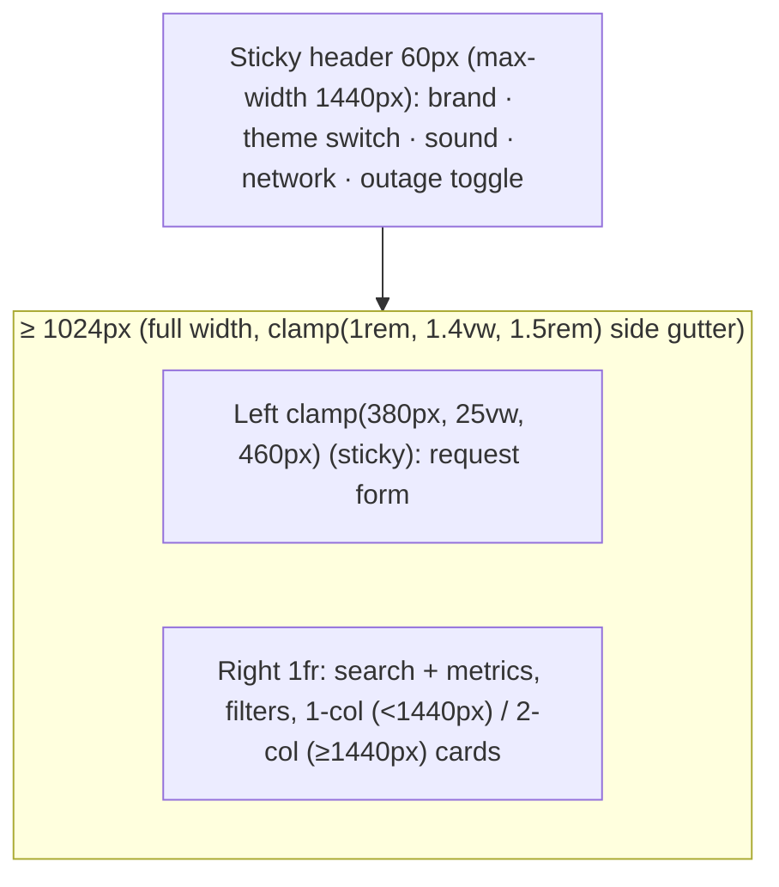

# BatCave Design System

> A minimal, monochrome interface system with a Stitch-inspired gradient flare and interactive halftone backdrop.
> **Reference implementation:** [CTU SmartDesk](https://github.com/rnznly/CTU-SmartDesk)
> **Version:** 1.2.0 &nbsp;·&nbsp; **Author:** Laurence Glenn Parojinog

Every value in this document is taken from the shipped source code (`css/styles.css`, `css/components.css`, `js/ui/interactiveHalftone.js`, `js/services/soundService.js`, `js/services/notificationService.js`). If you change the code, update this file to match.

---

## Contents

1. [Principles](#1-principles)
2. [Color](#2-color)
3. [Typography](#3-typography)
4. [Shape, Spacing & Elevation](#4-shape-spacing--elevation)
5. [Layout](#5-layout)
6. [Motion](#6-motion)
7. [Components](#7-components)
8. [Interactive Halftone & Stitch Flare Backdrop](#8-interactive-halftone--stitch-flare-backdrop)
9. [Audio Feedback](#9-audio-feedback)
10. [Theming](#10-theming)
11. [Accessibility](#11-accessibility)
12. [Do's and Don'ts](#12-dos-and-donts)
13. [Using This System in Your Project](#13-using-this-system-in-your-project)
14. [Credits & Inspiration](#14-credits--inspiration)

---

## 1. Principles

| Principle | What it means in practice |
| :--- | :--- |
| **Monochrome first** | The UI is built from one neutral scale plus `ink` and `bg`. Color only carries meaning (status, error) or ambience (the halftone). |
| **Borders, not shadows** | Surfaces are separated by 1px hairlines (`g200`). Shadows are almost invisible; only floating elements (toasts) get a real one. |
| **Type does the hierarchy** | Three families with distinct jobs: **Pixel** for brand moments, **Sans** for reading, **Mono** for data and labels. |
| **Quiet motion** | Short (150–220ms), expo-out easing, 1px hover lifts. The only continuous motion is the background canvas. |
| **One message at a time** | Toasts never stack. A new toast replaces the old one. |
| **Feedback is multi-sensory, but optional** | Every key action has an audio cue, and users can turn all audio off with one toggle. |

---

## 2. Color

### 2.1 How the tokens work

Neutral tokens are stored as **space-separated RGB triplets**, so you can use them at any opacity:

```css
:root      { --bg: 255 255 255; --ink: 10 10 10; --g200: 233 233 233; }
html.dark  { --bg: 12 12 15;    --ink: 244 244 245; --g200: 42 42 48; }

.surface   { background: rgb(var(--bg)); border: 1px solid rgb(var(--g200)); }
.header    { background: rgba(var(--bg) / 0.88); }   /* translucent */
```

> [!IMPORTANT]
> **The gray scale is relative, not absolute.** `g50` always means "barely different from the background" and `g950` always means "almost the same as ink". In light mode `g50` is near-white; in dark mode `g50` is near-black. Write components against the *role* of the step, and they will work in both themes automatically.

### 2.2 Neutral scale

| Token | Light | Dark | Role |
| :--- | :--- | :--- | :--- |
| `--bg` | `#FFFFFF` | `#0C0C0F` | Page and card background |
| `--ink` | `#0A0A0A` | `#F4F4F5` | Primary text, primary button fill, active filter fill |
| `--g50` | `#FAFAFA` | `#18181B` | Input fill, chip/badge fill |
| `--g100` | `#F5F5F5` | `#1E1E22` | Hover fill (filters), category badge fill |
| `--g200` | `#E9E9E9` | `#2A2A30` | **Default hairline border**, dividers |
| `--g300` | `#D4D4D4` | `#3A3A42` | Hover border, scrollbar thumb |
| `--g400` | `#A3A3A3` | `#8A8A92` | Placeholder, timestamps, idle icons |
| `--g500` | `#737373` | `#A0A0A8` | Secondary text, subtitles, inactive filters |
| `--g600` | `#525252` | `#B8B8C0` | Body copy on cards, badge text |
| `--g700` | `#404040` | `#CECED4` | Form labels |
| `--g800` | `#262626` | `#E4E4E8` | Reserved |
| `--g900` | `#171717` | `#F0F0F3` | Reserved |
| `--g950` | `#0A0A0A` | `#FAFAFA` | Reserved |

### 2.3 Semantic colors

| Token | Light | Dark | Used for |
| :--- | :--- | :--- | :--- |
| `--dot-pending` | `#D97706` | `#F59E0B` | Pending status dot, warning toast dot |
| `--dot-progress` | `#6366F1` | `#818CF8` | In-progress status dot |
| `--dot-resolved` | `#16A34A` | `#22C55E` | Resolved status dot, success toast dot, valid char counter, "copied" state |
| `--color-error` | `#DC2626` | `#DC2626` | Field errors, required star, error toast dot |
| `--color-error-bg` | `rgba(220,38,38,0.06)` | same | Invalid field tint |
| `--color-error-border` | `rgba(220,38,38,0.25)` | same | Invalid field border |
| info (literal) | `#6366F1` | `#6366F1` | Info toast dot |

Status color is shown **only as a 5px dot** inside a neutral pill. The pill itself stays monochrome.

### 2.4 Ambient & selection

| Token | Light | Dark |
| :--- | :--- | :--- |
| `--halftone` | `rgba(99,102,241,0.22)` | `rgba(167,139,250,0.25)` |
| `--sel-bg` / `--sel-fg` | `#0A0A0A` / `#FFFFFF` | `#FAFAFA` / `#0A0A0A` |

### 2.5 Identity tokens

| Token | Value | Status |
| :--- | :--- | :--- |
| `--ctu-maroon` | `#7B1113` | Defined, **not currently applied** in the UI |
| `--ctu-gold` | `#F2A900` | Defined, **not currently applied** in the UI |

These are slots for an organization's brand colors. If you adopt the system, replace them with your own (see [§13](#13-using-this-system-in-your-project)).

---

## 3. Typography

### 3.1 Families

| Family | Token | Source | Job |
| :--- | :--- | :--- | :--- |
| **Geist** | `--font-sans` | Google Fonts (weights 300–700) | Reading text: names, descriptions, inputs, labels, toasts |
| **Geist Mono** | `--font-mono` | Google Fonts (weights 400–600) | Data and labels: IDs, timestamps, counters, tags, filters, eyebrows |
| **Geist Pixel** | `--font-pixel` | jsDelivr: `vercel/geist-pixel-font` (Square, `.woff2`) | Brand moments only: app title, card titles, primary button |

```html
<link rel="preconnect" href="https://fonts.googleapis.com" />
<link rel="preconnect" href="https://fonts.gstatic.com" crossorigin />
<link href="https://fonts.googleapis.com/css2?family=Geist:wght@300;400;500;600;700&family=Geist+Mono:wght@400;500;600&display=swap" rel="stylesheet" />
```

```css
@font-face {
  font-family: 'Geist Pixel';
  src: url('https://cdn.jsdelivr.net/gh/vercel/geist-pixel-font@main/fonts/webfonts/GeistPixel-Square.woff2') format('woff2');
  font-display: swap;
}
```

### 3.2 Type scale

| Style | Family | Size | Weight | Tracking | Example |
| :--- | :--- | :--- | :--- | :--- | :--- |
| Brand title | Pixel | 18px (1.125rem) | 400 | -0.01em | `CTU SmartDesk` |
| Card title | Pixel | 18.4px (1.15rem) | 400 | -0.01em | Form heading |
| Button | Pixel | 15px (0.9375rem) | 400 | +0.04em | Submit Request |
| Name | Sans | 15px | 600 | -0.015em | Student name on a card |
| Body / input | Sans | 14px (0.875rem) | 400 | 0 | Form fields |
| Label | Sans | 13px (0.8125rem) | 500 | -0.01em | Field labels |
| Description | Sans | 13px | 400 | 0, line-height 1.5 | Card body |
| Toast | Sans | 13px | 400 | -0.01em | Notification text |
| Eyebrow | Mono | 11px (0.6875rem) | 500 | +0.03em, uppercase | Subtitles, footer notes |
| ID chip | Mono | 11px | 600 | +0.02em | `CTU-REQ-20261109-8F2B` |
| Filter | Mono | 11px | 500 (600 active) | +0.04em, uppercase | `ALL` `PENDING` |
| Tag / badge | Mono | 10px (0.625rem) | 500 | +0.04–0.05em, uppercase | Status and category pills |

**Rule of thumb:** sans text gets *negative* tracking, uppercase mono gets *positive* tracking.

---

## 4. Shape, Spacing & Elevation

### 4.1 Radius

| Token | Value | Applied to |
| :--- | :--- | :--- |
| `--radius-sm` | 4px | Compact controls (legacy chip baseline; ID chips use `6px`) |
| `--radius-md` | 8px | Base medium corners (`10px` used on frosted inputs & submit button) |
| `--radius-lg` | 10px | Large baseline containers |
| `--radius-glass-card` | 16px | Feed `.request-card` surfaces |
| `--radius-glass` | 18px | Main container panels (`.surface-card`, `.dashboard-controls-card`, `#empty-state-view`) |
| `--radius-full` | 9999px | Status/category badges, action pills, filters, toasts, theme switch |

### 4.2 Spacing

Spacing follows a 4px rhythm with a few 2px half-steps for dense components. Values in use:

`2 · 4 · 6 · 8 · 10 · 12 · 16 · 18 · 20 · 22 · 24 · 28 · 32 · 48` px

| Context | Value |
| :--- | :--- |
| Surface card padding | 22px (1.375rem) |
| Request card padding | 16px × 18px |
| Gap between form groups | 18px |
| Gap between request cards | 12px |
| Label-to-input gap | 6px |
| Page padding | 24px (bottom 48px) |

### 4.3 Elevation & Frosted Glass Surfaces

Panels use translucent frosted glass (`--glass-bg`) with backdrop blur (`--glass-blur`: `blur(24px) saturate(180%)` in light mode, `blur(24px) saturate(150%)` in dark mode) so the underlying Stitch flare and halftone dots diffuse gently behind cards, separated by crisp hairline borders (`--glass-border`) and inner top-edge bevel highlights (`--glass-shadow`).

| Surface / Level | Spec | Used on |
| :--- | :--- | :--- |
| Glass panel (light) | `linear-gradient(145deg, rgba(255,255,255,0.56), rgba(241,245,255,0.34), rgba(246,244,255,0.44))` + `blur(24px) saturate(180%)`, border `rgba(15,23,42,0.11)` | `.surface-card`, `.dashboard-controls-card`, `.request-card`, `#empty-state-view` |
| Glass panel (dark) | `linear-gradient(145deg, rgba(24,26,38,0.62), rgba(12,13,21,0.50))` + `blur(24px) saturate(150%)`, border `rgba(255,255,255,0.12)` | `.surface-card`, `.dashboard-controls-card`, `.request-card`, `#empty-state-view` |
| Glass field / chip | `--glass-field-bg` / `--glass-chip-bg` (`rgba(15,23,42,0.032)` / `rgba(255,255,255,0.48)` light, `rgba(255,255,255,0.045–0.055)` dark) | `.form-control`, `.custom-select-trigger`, `#search-input`, chips & badges |
| Float (light) | `0 10px 25px rgba(0,0,0,0.08), 0 0 0 1px rgba(0,0,0,0.04)` + `blur(16px)` | Toasts |
| Float (dark) | `0 14px 34px -4px rgba(0,0,0,0.65), 0 0 0 1px rgba(255,255,255,0.06)` | Toasts |

Interactive cards signal hover by brightening `--glass-border` to `--glass-border-hover`, switching to `--glass-shadow-hover`, and lifting 1px.

---

## 5. Layout

| Property | Value |
| :--- | :--- |
| Header | Sticky, 60px tall, `rgba(var(--bg) / 0.88)` with `backdrop-filter: blur(12px)`, bottom hairline |
| Header max width | 1440px (`margin: 0 auto`, horizontal bar padding `1.5rem`) |
| Brand title lockup | `.brand-titles` centers `CTU SmartDesk` vertically in the 60px header bar in alignment with `.system-controls` |
| Content width | Full viewport width (`width: 100%`), horizontal padding `clamp(1rem, 1.4vw, 1.5rem)` |
| Mobile (< 1024px) | Single column, 24px gap (`1.5rem`) |
| Desktop (≥ 1024px) | Two columns: `clamp(380px, 25vw, 460px) 1fr`, `clamp(1.25rem, 1.5vw, 1.75rem)` gap. Left column (form) is sticky at `top: 78px` |
| Wide feed (≥ 1440px) | `#requests-container` switches to a 2-column equal-height grid (`repeat(2, minmax(0, 1fr))`) so cards fill wide displays cleanly |
| Search + metrics row | Stacks below 640px, inline at ≥ 640px |
| Filter row | Horizontally scrollable on overflow |
| Scrollbars | 6px, transparent track, `g300` thumb (hover `g400`), fully rounded |



---

## 6. Motion

| Token | Value | Used for |
| :--- | :--- | :--- |
| `--transition-fast` | `150ms cubic-bezier(0.16, 1, 0.3, 1)` | Hover, focus, color changes |
| `--transition-normal` | `220ms cubic-bezier(0.16, 1, 0.3, 1)` | Theme background/border changes |

| Pattern | Spec |
| :--- | :--- |
| Hover lift | `transform: translateY(-1px)` (primary button, request cards) |
| Button press | Returns to `translateY(0)` |
| Toast enter | 200ms, from `opacity 0, translateY(10px) scale(0.96)` |
| Toast exit | 180ms, to `opacity 0, translateY(6px) scale(0.96)` |
| Theme switch | Circular reveal using the View Transitions API, starting from the clicked button. Skipped when `prefers-reduced-motion: reduce` is set or the API is unavailable. |

The easing `cubic-bezier(0.16, 1, 0.3, 1)` is an expo-out curve: fast start, soft landing.

---

## 7. Components

### 7.1 Surface card
```css
background: var(--glass-bg);
backdrop-filter: var(--glass-blur);
-webkit-backdrop-filter: var(--glass-blur);
border: 1px solid var(--glass-border);
border-radius: var(--radius-glass); /* 18px */
padding: 1.375rem;
box-shadow: var(--glass-shadow);
```
The header area is separated from the body by a `--glass-divider` bottom border. The title is set in **Pixel**.

### 7.2 Primary button (`#btn-submit-request`)
| Property | Value |
| :--- | :--- |
| Fill / border | `ink` (the button inverts the page: black in light mode, white in dark mode) |
| Text | `bg` color, Pixel 15px, +0.04em |
| Shape | Full width, min-height 42px, radius 10px |
| Hover | `opacity: 0.86`, lift 1px |
| Disabled | `opacity: 0.45`, `cursor: not-allowed`, no lift |
| Sound | Two-note confirmation chime (see §9) |

### 7.3 Text link button (`.btn-quick-fill`)
Mono 11px, uppercase, underlined, `ink` color, no background. Hover drops to `opacity: 0.65`.

### 7.4 Input (`.form-control`)
| State | Spec |
| :--- | :--- |
| Rest | `--glass-field-bg` fill, `--glass-field-border` border, radius 10px, min-height 40px, Sans 14px |
| Placeholder | `g400` |
| Hover | Border `--glass-border-hover` |
| Focus | Border `ink`, `--glass-field-focus` fill |
| Invalid | `--color-error-border` border with `--color-error-bg` tint, plus an error message below |

**Character counter:** Mono 11px in `g400`. It switches to `--dot-resolved` once the minimum length is reached.

### 7.5 Custom select
Native `<select>` stays in the DOM for form semantics and is visually replaced by:
- **Trigger:** Same look as `.form-control`, with a chevron that rotates when open.
- **Menu:** Frosted glass floating panel (`--glass-menu-bg`, `--glass-blur`, radius 12px) with a `dropdownFadeIn` animation. Toggled with the `hidden` attribute.
- **Option:** Hover fills `g100` (light) / `rgba(255,255,255,0.08)` (dark). The selected option shows a checkmark.
- **Keyboard:** `Enter`, `Space`, and `ArrowDown` open the menu. `Escape` closes it.
- **Sound:** Typewriter tick on option hover, pen click on select.

### 7.6 Filter pills (`#filter-container button`)
| State | Spec |
| :--- | :--- |
| Rest | Transparent, `g500` text, Mono 11px uppercase, padding 4px × 10px, fully rounded |
| Hover | `--glass-hover-bg` fill, `ink` text |
| Active | `ink` fill, `bg` text, weight 600 (inverted, like the primary button) |

### 7.7 Request card (`.request-card`)
```
┌ ID chip [copy]  · timestamp ─────────────────┐
│ Student name                    CATEGORY tag │
│ Description (g600, 13px, pre-wrap)           │
├──────────────────────────────────────────────┤
│ ● STATUS badge               [ACTION] button │
└──────────────────────────────────────────────┘
```
- Container: `--glass-bg` frosted glass fill + `--glass-blur`, `--glass-border`, radius `--radius-glass-card` (`16px`), padding `1.0625rem × 1.1875rem`, 10px internal gap.
- Hover: border `--glass-border-hover`, `--glass-shadow-hover`, lift 1px, typewriter tick.
- **ID chip:** `--glass-chip-bg` fill, `--glass-field-border` border, radius 6px, Mono 11px/600.
- **Copy button:** Idle `g400`, hover `ink`, `.copied` turns `--dot-resolved`. Plays the Scribblenauts sound.
- **Category tag:** Mono 10px uppercase pill on `--glass-chip-bg`.
- **Footer:** Separated by a `--glass-divider` top border.

### 7.8 Status badge (`.status-badge`)
A neutral Mono 10px uppercase pill (`--glass-chip-bg` fill, `--glass-field-border` border) with a **5px colored dot** in front:

| Class | Dot |
| :--- | :--- |
| `.status-pending` | `--dot-pending` |
| `.status-in-progress` | `--dot-progress` |
| `.status-resolved` | `--dot-resolved` |

The pill has no colored background and no glow. Labels come from configuration (`REQUEST_STATUS` in `constants.js`), never hardcoded in markup.

**Status action button** (`.btn-status-action`): Mono 10px, pill radius (`9999px`), `--glass-chip-bg` fill. On hover it inverts to an `ink` fill.

### 7.9 Toast (`.toast-item`)
| Property | Value |
| :--- | :--- |
| Position | Fixed, **bottom-right** (24px inset) |
| Shape | Fully rounded pill, min-height 32px |
| Surface | Light `rgba(255,255,255,0.95)` / dark `rgba(14,14,18,0.94)`, 16px backdrop blur |
| Dot | 6px, with `0 0 8px` glow at 60% of the dot color |
| Text | Sans 13px, single line |
| Close | 18px circular button, `g400` at 60% opacity |
| **Stacking** | **Never.** Showing a toast removes any existing one first |

| Type | Dot color | Default duration |
| :--- | :--- | :--- |
| `success` | `--dot-resolved` | 3000ms |
| `warning` | `--dot-pending` | 3500ms |
| `error` | `--color-error` | 5000ms |
| `info` | `#6366F1` | 2200ms |

### 7.10 Header controls
- **Theme switch:** Segmented, fully rounded control with three icon buttons (`system`, `light`, `dark`), each with an `aria-label`.
- **Sound toggle:** Icon button with `aria-pressed`. The state is saved in `localStorage` under `smartdesk_sounds_enabled`.
- **Network badge:** Pill with a status dot. Gets an `.offline` modifier when the connection drops.
- **Outage toggle:** Custom pill switch (CSS-drawn checkbox). Gets an `.active` modifier when enabled.

---

## 8. Interactive Halftone & Stitch Flare Backdrop

The fixed backdrop (`.backdrop-halftone-container`, `position: fixed; inset: 0; z-index: 0; pointer-events: none`) layers a Stitch-inspired diagonal gradient flare aura (`z-index: 0`) directly underneath the full-viewport `<canvas>` (`#halftone-canvas`, `z-index: 1`, driven by `js/ui/interactiveHalftone.js`), so reactive dots stay crisp above the glowing beams.

### 8.1 Parameters

| Parameter | Value | Meaning |
| :--- | :--- | :--- |
| `spacing` | 15px | Grid pitch |
| `dotRadiusBase` | 0.75px | Resting dot radius (1.5px diameter) |
| `mouseRadius` | 173px | Pointer influence radius |
| `repulsionStrength` | 21.9px | Maximum push distance |
| `reactiveGrowth` | 1.18px | Extra radius at the cursor's center |
| `reactiveLuminescence` | 0.86 | Extra alpha at the cursor's center |
| time step | 0.024 per frame | Wave speed |
| spring | 0.12 | Lerp factor toward the target position |

### 8.2 Per-frame algorithm

```js
// Base alpha is fixed per dot at grid build time (range 0.22 – 0.38)
baseAlpha = 0.22 + (Math.sin(col * 0.5) * Math.cos(row * 0.5) + 1) * 0.08;

// 1. Ambient wave
targetX = originX + Math.sin(time + originY * 0.024) * 2.25;
targetY = originY + Math.cos(time + originX * 0.024) * 2.25;

// 2. Pointer repulsion (only inside mouseRadius)
force     = 1 - dist / mouseRadius;        // 1 at cursor, 0 at edge
proximity = force * force;                 // quadratic falloff for size/alpha
targetX  -= Math.cos(angle) * force * 21.9;
targetY  -= Math.sin(angle) * force * 21.9;

// 3. Spring toward target
x += (targetX - x) * 0.12;
y += (targetY - y) * 0.12;

// 4. Size and alpha
radius  = 0.75 + proximity * 1.18;
shimmer = Math.sin(time * 1.4 + originX * 0.018) * 0.08;
alpha   = clamp(baseAlpha + shimmer + proximity * 0.86, 0.12, 1);
```

### 8.3 Dot colors

| Theme | Ambient (`proximity ≤ 0.08`) | Highlight (`proximity > 0.08`) |
| :--- | :--- | :--- |
| Dark | `rgba(167, 139, 250, α)` violet | `rgba(196, 181, 253, α)` lavender |
| Light | `rgba(139, 92, 246, α)` purple | `rgba(99, 102, 241, α)` indigo |

### 8.4 Behavior rules
- **Pauses when the tab is hidden** (`visibilitychange` cancels the animation frame).
- **Re-reads the theme** on toggle via `onThemeChange()`.
- **CSS fallback:** If the canvas never mounts, two masked `radial-gradient` dot fields render instead (15px grid, fading out from the top-right and bottom-left corners). When the canvas is active, the container gets `.has-canvas` and the fallback is hidden.

### 8.5 Stitch-inspired animated gradient flare
Inside `.backdrop-halftone-container`, `.stitch-flare-layer` (`z-index: 0`) renders three heavily blurred, GPU-composited (`will-change: transform, opacity`) aura shapes underneath `#halftone-canvas`:

| Layer | Geometry & Motion | Palette |
| :--- | :--- | :--- |
| `.stitch-flare-left` | Lower-left diagonal sweep (`78vw × 52vh`, `blur(60px)`), `stitchFlareDriftLeft` (`18s ease-in-out infinite alternate`) | Violet outer halo (`139, 92, 246`), indigo shoulder (`99, 102, 241`), electric cobalt/blue core (`59, 130, 246` / `96, 165, 250`) |
| `.stitch-flare-right` | Mid/lower-right opposing sweep (`68vw × 46vh`, `blur(62px)`), `stitchFlareDriftRight` (`22s ease-in-out -4s infinite alternate`) | Indigo-violet skirt with cobalt/cyan-blue core (`96, 165, 250` / `56, 189, 248`) |
| `.stitch-flare-ambient` | Lower-center horizon bloom (`68vw × 44vh`, `blur(76px)`), `stitchFlarePulse` (`14s ease-in-out infinite alternate`) | Soft radial indigo (`99, 102, 241`) and blue (`59, 130, 246`) wash |

- **Light vs. Dark tuning:** Light mode uses vibrant studio washes (`0.18–0.36` alpha) so the sky-blue/indigo flare illuminates visibly through frosted acrylic light cards while preserving `#0A0A0A` ink contrast; `html.dark` boosts the obsidian aurora glow (`0.20–0.62` alpha).
- **Responsive tightening (`≤ 767px`):** Widen beams to `96vw` / `90vw` / `92vw` with reduced blur (`46px`–`56px`) so flares remain visible on portrait screens.
- **Reduced motion:** `@media (prefers-reduced-motion: reduce)` sets `.stitch-flare { animation: none; }` and locks static rotated positions (`34deg` / `-30deg`).

---

## 9. Audio Feedback

Audio is preloaded into Web Audio buffers after the first user interaction (browsers block autoplay before that). Users can turn all sound off with the header toggle.

| Trigger | Sound | Source | Volume |
| :--- | :--- | :--- | :--- |
| Submit request, sound toggle | Two-note confirmation chime | Synthesized | master 0.38 |
| Fill sample ticket, copy request ID | Scribblenauts key press | `assets/sounds/scribblenauts.mp3` | 0.65 (100ms throttle) |
| Outage toggle | Switch notification | `assets/sounds/switch_notification.mp3` | 0.60 |
| Filters, status actions, theme options, other clicks | Pen click | `assets/sounds/click_pen.mp3` | 0.55 |
| Pointer entering a surface card, request card, header, metrics strip, filter pill, or select option | Typewriter tick | `assets/sounds/typewriter.mp3` | 0.40 (fires once per entry, 100ms throttle) |

**Chime recipe:** sine C6 (1046.5 Hz) plus its octave. 85ms later, sine G6 (1568 Hz) plus its octave. Each note has a 5ms attack and exponential decay. A light feedback "shimmer" (lowpass at 4200 Hz) is mixed in.

---

## 10. Theming

| Mode | Behavior |
| :--- | :--- |
| `light` | Default `:root` tokens |
| `dark` | `html.dark` overrides the tokens and sets `color-scheme: dark` |
| `system` | Follows `prefers-color-scheme` |

Only tokens change between themes. Component CSS stays the same, which is why every component must use `rgb(var(--token))` instead of literal colors. The few exceptions (toast surfaces, menu/option hovers, sound/theme controls) are explicit `html.dark` overrides.

---

## 11. Accessibility

**What the system already does:**
- `:focus-visible` shows a 2px `ink` outline with a 2px offset.
- Icon-only controls carry `aria-label`. Toggles use `aria-pressed`.
- The custom select keeps the native `<select>` and supports `Enter`, `Space`, `ArrowDown`, and `Escape`.
- The theme transition and `.stitch-flare` gradient backdrop respect `prefers-reduced-motion`.
- Status is never shown by color alone: every badge has a text label.

**Guidance and known gaps:**
- **`g400` is for decoration and placeholders only.** In light mode, `#A3A3A3` on white is about 2.5:1, below WCAG AA for body text. Use `g500` or darker for any text users must read.
- **The interactive halftone JS canvas (`#halftone-canvas`) does not yet respect `prefers-reduced-motion`.** Recommended: render a static dot grid (skip the wave and repulsion) when reduced motion is requested.
- Audio cues are supplementary. Never make sound the only signal for an outcome.

---

## 12. Do's and Don'ts

| ✅ Do | ❌ Don't |
| :--- | :--- |
| Use `rgb(var(--gNNN))` so components work in both themes | Hardcode hex colors in component CSS |
| Separate surfaces with a `g200` hairline | Add drop shadows to cards |
| Show status as a 5px dot in a neutral pill | Fill badges with saturated backgrounds or glows |
| Reserve **Pixel** for the brand title, card titles, and the primary button | Set body text or long labels in Pixel |
| Use **Mono** uppercase with positive tracking for data and tags | Use Mono for paragraphs |
| Keep exactly one primary (inverted `ink`) button per view | Use multiple competing filled buttons |
| Replace the current toast | Stack toasts |
| Keep motion within 150–220ms with expo-out easing | Add bounce, long fades, or parallax |
| Provide an off switch for audio | Play sound on page load |

---

## 13. Using This System in Your Project

**Minimum setup:**
1. Copy the token blocks (`:root` and `html.dark`) from `css/styles.css`.
2. Load Geist, Geist Mono, and Geist Pixel as shown in §3.1.
3. Build components from the specs in §7 using only tokens.
4. *(Optional)* Add `interactiveHalftone.js`, a `.stitch-flare-layer`, and `<canvas class="halftone-canvas">` inside `.backdrop-halftone-container`.
5. *(Optional)* Add audio using your own sound files, and include an off switch.

**Rebranding:**
- Replace `--ctu-maroon` and `--ctu-gold` with your organization's colors.
- Change the halftone colors in §8.3 and the `.stitch-flare` gradients in §8.5 to shift the ambient backdrop mood.

> [!WARNING]
> **License terms.** This design system, its tokens, and its patterns may be studied, referenced, and adapted under the project's [MIT License](../LICENSE). Under the license's Supplemental Trademark & Branding Notice, you **may not** use Cebu Technological University's name, seal, or logos, or misrepresent authorship on public forks or deployments. Use your own branding and keep attribution.

---

## 14. Credits & Inspiration

This system was designed by **Laurence Glenn Parojinog** for CTU SmartDesk. It draws on publicly visible ideas from:

- **[bryllim.com](https://bryllim.com):** Monochrome palette, halftone dot texture, pixel-font branding, minimalist tag pattern.
- **[Vercel Geist](https://vercel.com/font):** Geist, Geist Mono, and Geist Pixel typefaces.
- **Google Stitch:** Pointer-reactive dot canvas and diagonal sweeping gradient flare backdrop.
- **[Linear](https://linear.app):** Hairline-border depth and restrained motion.

The tokens, components, and halftone engine were written for this project. Fonts are loaded from their official distributions and are not bundled.

> [!NOTE]
> The `.mp3` sound effects in `assets/sounds/` are third-party audio clips, and this design system does not license them. If you adopt the system, use sounds you have the rights to.

---

*Changelog*
- **1.2.0** (2026-11-16): Converted panel, control, card, and empty-state boxes to Stitch-inspired frosted liquid glass (`--glass-bg`, `--glass-blur`, `--glass-shadow`, `16px–18px` radii, and translucent light/dark inner fields/chips), and vertically centered `.brand-titles` in the 60px header.
- **1.1.0** (2026-11-16): Added Stitch-inspired animated gradient flare layer beneath `#halftone-canvas` (`@keyframes` + `prefers-reduced-motion`), kept `.header-inner` at `1440px` while removing the `.main-workspace` `1400px` max-width cap in favor of full-width fluid gutters (`clamp(1rem, 1.4vw, 1.5rem)`) plus a 2-column feed grid at `≥ 1440px`, and documented subtitle-free `.brand-titles` vertical spacing preservation.
- **1.0.0** (2026-11-12): Rewritten to match the shipped implementation. Corrected tokens, type scale, canvas parameters, toast position, and audio map. Added accessibility, theming, do's and don'ts, and adoption sections.
