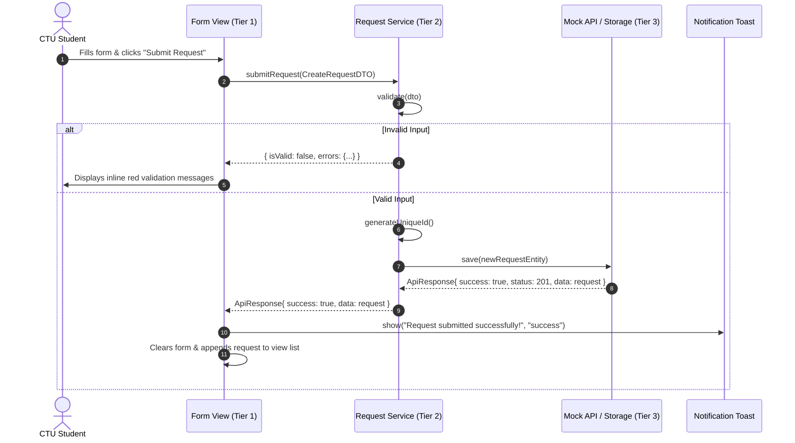
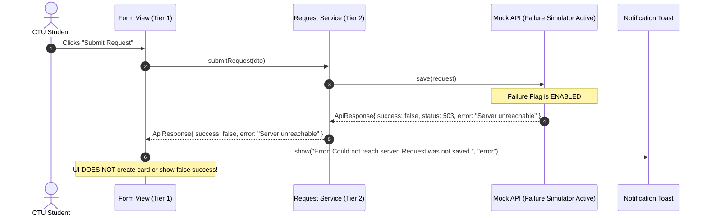

# CTU Smart Campus Service Request System
## System Architecture & Loose Coupling Specification

> **Course:** CC316 – Applications Development and Emerging Technologies  
> **Institution:** Cebu Technological University (CTU)  
> **Evaluation Area:** Part II – Application Architecture and Loose Coupling (20 Points)  
> **Document Type:** System Architectural Blueprint & Interaction Model  

---

## 1. High-Level 3-Tier Architecture Diagram

The CTU Smart Campus Service Request System implements a strict **Three-Tier Modular Architecture** demonstrating **Loose Coupling** and **High Cohesion**. No component directly bypasses adjacent layers.

```mermaid
flowchart TD
    subgraph Tier1["1. CLIENT / USER INTERFACE LAYER (Presentation)"]
        UI_HTML["HTML5 Semantic View<br/>(index.html)"]
        UI_FORM["Form Controller<br/>(formView.js)"]
        UI_LIST["List & Card Renderer<br/>(listView.js)"]
        UI_NOTIF["Feedback & Toasts<br/>(notificationService.js)"]
    end

    subgraph Tier2["2. APPLICATION / SERVICE LAYER (Business Logic)"]
        SVC_REQ["Request Service Controller<br/>(requestService.js)"]
        SVC_VAL["Validation Engine<br/>(Validator)"]
        SVC_ID["ID Generation Module<br/>(Unique Collision-Resistant ID)"]
        SVC_CFG["Configuration & State Contract<br/>(constants.js)"]
    end

    subgraph Tier3["3. DATA MANAGEMENT LAYER (Persistence & Integration)"]
        DATA_API["Mock API Client / Endpoint<br/>(mockApi.js)"]
        DATA_STORE["Local Storage Gateway<br/>(storageService.js)"]
        DATA_SIM["Failure Simulator<br/>(Challenge A Harness)"]
    end

    subgraph PWA["PROGRESSIVE WEB APP INFRASTRUCTURE"]
        PWA_SW["Service Worker<br/>(service-worker.js)"]
        PWA_CACHE["Cache Storage<br/>(HTML, CSS, JS, Assets)"]
        PWA_MAN["Web App Manifest<br/>(manifest.json)"]
    end

    %% Interactions
    UI_FORM -->|"1. Submits CreateRequestDTO"| SVC_REQ
    UI_LIST -->|"2. Requests Filtered Data"| SVC_REQ
    SVC_REQ -->|"3. Validates Inputs"| SVC_VAL
    SVC_REQ -->|"4. Generates Unique ID"| SVC_ID
    SVC_REQ -->|"5. Reads Dynamic Statuses"| SVC_CFG
    SVC_REQ -->|"6. Calls Storage Contract"| DATA_API
    DATA_API -->|"7. Persists Request Object"| DATA_STORE
    DATA_API -.->|"Simulated 500 / Network Error"| DATA_SIM
    DATA_API -->|"8. Returns ApiResponse&lt;T&gt;"| SVC_REQ
    SVC_REQ -->|"9. Returns Processed Result"| UI_LIST
    SVC_REQ -->|"10. Dispatches Feedback Event"| UI_NOTIF

    %% PWA Relationships
    PWA_SW -->|"Caches & Intercepts"| UI_HTML
    PWA_SW -->|"Stores Offline Assets"| PWA_CACHE
    PWA_MAN -.->|"Installs Application"| UI_HTML

    classDef tier1 fill:#E8F0FE,stroke:#1A73E8,stroke-width:2px;
    classDef tier2 fill:#FEF7E0,stroke:#F9AB00,stroke-width:2px;
    classDef tier3 fill:#E6F4EA,stroke:#137333,stroke-width:2px;
    classDef pwa fill:#FCE8E6,stroke:#D93025,stroke-width:2px;

    class UI_HTML,UI_FORM,UI_LIST,UI_NOTIF tier1;
    class SVC_REQ,SVC_VAL,SVC_ID,SVC_CFG tier2;
    class DATA_API,DATA_STORE,DATA_SIM tier3;
    class PWA_SW,PWA_CACHE,PWA_MAN pwa;
```



---

## 2. Layer Responsibilities & Component Isolation

### Tier 1: Client / User Interface Layer
* **Files:** `index.html`, `css/styles.css`, `css/components.css`, `js/ui/formView.js`, `js/ui/listView.js`, `js/services/notificationService.js`
* **Responsibilities:**
  * Renders semantic HTML markup, forms, filter controls, and list items.
  * Captures raw user events (clicks, inputs, status updates).
  * Passes plain data objects (`CreateRequestDTO`) to Tier 2.
  * Displays user-facing feedback (toasts, validation labels, offline indicators).
* **Isolation Rule:** The UI **never** accesses `localStorage`, directly manages database state, or enforces validation rules internally. It only displays what Tier 2 returns.

### Tier 2: Application / Service Layer
* **Files:** `js/services/requestService.js`, `js/config/constants.js`
* **Responsibilities:**
  * Enforces business rules: validates student name, concern type, and description constraints.
  * Generates collision-resistant unique Request IDs (`CTU-REQ-{YYYYMMDD}-{HEX}`).
  * Applies search algorithms and status filtering.
  * Orchestrates status transitions (`Pending` &rarr; `In Progress` &rarr; `Resolved`).
* **Isolation Rule:** The Application Layer is **independent of the DOM**. It can be unit-tested without any browser UI or web page loaded.

### Tier 3: Data Management Layer
* **Files:** `js/data/mockApi.js`, `js/data/storageService.js`
* **Responsibilities:**
  * Serves as the single source of truth for persisted data.
  * Wraps storage operations inside standardized `ApiResponse<T>` promises.
  * Contains the **Simulated Server Failure** test harness for Technical Challenge A.
* **Isolation Rule:** Can be replaced with a live REST or GraphQL server backend with zero code changes required in Tier 1 (UI) or Tier 2 (Validation/Business Logic).

---

## 3. Communication Sequence Diagrams

### 3.1 Successful Service Request Submission


### 3.2 Technical Challenge A: Simulated Server Failure Handling


---

## 4. Loose Coupling Demonstration (Part II HOTS Challenge)

### The Requirement:
> Cebu Technological University decides to change the request lifecycle statuses from:  
> **`Pending` &rarr; `In Progress` &rarr; `Resolved`**  
> to:  
> **`Submitted` &rarr; `Under Review` &rarr; `Completed`**  
>
> *Demonstrate how your application architecture accommodates this modification without unnecessarily changing unrelated modules.*

### Architecture Proof of Loose Coupling:
1. **Zero Hardcoded Strings:** Neither `formView.js`, `listView.js`, nor `storageService.js` hardcodes status literals like `"Pending"`.
2. **Central Configuration Authority:** The statuses are exclusively defined in `js/config/constants.js`:

```javascript
// js/config/constants.js

// ORIGINAL:
export const REQUEST_STATUS = {
  PENDING: "Pending",
  IN_PROGRESS: "In Progress",
  RESOLVED: "Resolved"
};

// MODIFIED (Single point of change):
export const REQUEST_STATUS = {
  PENDING: "Submitted",
  IN_PROGRESS: "Under Review",
  RESOLVED: "Completed"
};
```

3. **Autonomous Propagation:**
   * **Filter Buttons:** Automatically generate filters by iterating over `Object.values(REQUEST_STATUS)`.
   * **Status Badges:** Color classes and labels map dynamically via configuration keys.
   * **Validation:** Validates that incoming transitions match valid keys in `REQUEST_STATUS`.
   * **Storage & Persistence:** Stores strings as-is without requiring database schema rewrites.
4. **Result:** Modifying **3 lines** in `constants.js` successfully updates the entire application without touching UI rendering logic, event listeners, or storage handlers.
