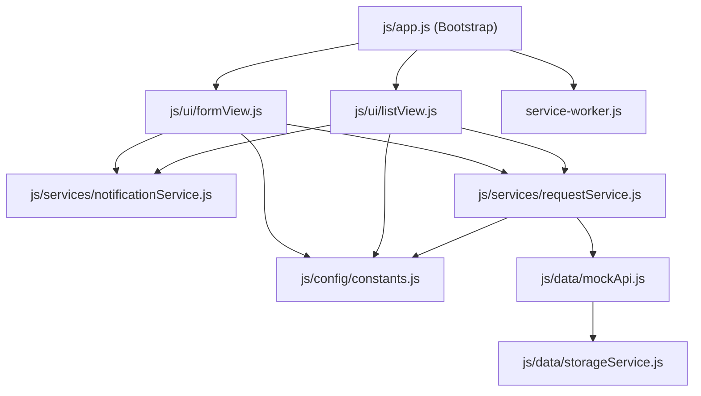

# CTU Smart Campus Service Request System
## Technical Implementation Blueprint
### Stack: Vanilla JavaScript (ES6 Modules) + HTML5 + CSS3 (PWA)

> **Course:** CC316 – Applications Development and Emerging Technologies  
> **Institution:** Cebu Technological University (CTU)  
> **Document Purpose:** Complete architectural blueprint, module dependency graph, and code-level design prior to implementation.

---

## 1. Directory Tree & File Inventory

```text
ctu-smart-campus/
│
├── index.html                   # Master semantic layout with responsive grid
├── manifest.json                # PWA manifest specification (standalone mobile experience)
├── service-worker.js            # PWA Service Worker (Cache-First static assets, offline detection)
├── README.md                    # Setup, execution guide, and evaluation mapping
│
├── css/
│   ├── styles.css               # Design tokens, variables (CTU colors), reset, layout grid
│   └── components.css           # Forms, inputs, buttons, cards, status badges, toast alerts
│
├── js/
│   ├── app.js                   # Application bootstrap, event wiring, and SW registration
│   │
│   ├── config/
│   │   └── constants.js         # Single Source of Truth: Statuses, Categories, Validation Rules
│   │
│   ├── data/
│   │   ├── storageService.js    # LocalStorage persistence gateway & initial seed data
│   │   └── mockApi.js           # Async API client with latency & Server Failure simulator
│   │
│   ├── services/
│   │   ├── requestService.js    # Core Business Logic: Validation, Unique ID, Status State Machine
│   │   └── notificationService.js # User feedback toast/alert manager
│   │
│   └── ui/
│       ├── formView.js          # Form event handling, real-time input validation rendering
│       └── listView.js          # Request card rendering, search bar, and filter tabs
│
├── assets/
│   ├── icons/
│   │   ├── icon-192x192.png     # PWA app icon for mobile devices
│   │   └── icon-512x512.png     # PWA splash screen icon
│   └── ctu-logo.svg             # CTU official emblem / vector badge
│
└── docs/
    ├── contracts.md             # Formal Contract-First specifications & API models
    ├── architecture-diagram.md  # 3-Tier Architecture & loose coupling proof
    ├── usability-testing.md     # Completed usability testing report & HOTS analysis
    ├── video-presentation-script.md # 9-step rehearsal guide for video recording
    └── implementation-blueprint.md  # (This Document) Detailed technical blueprint
```

---

## 2. Module Dependency Graph (Strict Unidirectional Flow)

To ensure **loose coupling** and eliminate circular dependencies, data and control flow in a single direction:



---

## 3. Detailed Component Blueprint

### 3.1 `index.html` (Semantic Layout)
* **Header / Navigation:**
  * CTU Smart Campus Branding (`CTU SmartDesk`).
  * Real-time network status pill: `Online` (Green) / `Offline` (Gray).
  * Dev-Test Controls: "Simulate Server Failure" toggle (for Challenge A).
* **Toast Notification Container:** Dedicated container fixed at the top-right for accessible alerts.
* **Main Content Area (Responsive 2-Column Grid on Desktop, 1-Column on Mobile):**
  * **Column 1 (Left / Top):** The Service Request Form (`#service-request-form`).
    * Input: Student Full Name (`#student-name`) + validation helper.
    * Select: Concern Type (`#concern-type`) populated dynamically from `constants.js`.
    * Textarea: Concern Description (`#concern-description`) with live character counter (`#char-count`).
    * Date display (auto-populated with current date).
    * Submit Button (`#btn-submit`) with loading state indicator.
  * **Column 2 (Right / Bottom):** The Request Management Dashboard.
    * Toolbar: Search input (`#search-input`) + Status filter pills (`All`, `Pending`, `In Progress`, `Resolved`).
    * Stats bar: Total count, Pending count, Resolved count.
    * Feed Container (`#requests-list`): Renders dynamically generated request cards.
    * Empty State Display: Illustrated prompt when no matching requests are found.

---

### 3.2 CSS Architecture (`css/styles.css` & `css/components.css`)
* **Design Tokens & Theme Variables:**
  * `--ctu-maroon: #7B1113;` (CTU primary brand color)
  * `--ctu-gold: #F2A900;` (CTU secondary accent)
  * `--color-success: #1E7E34;`
  * `--color-warning: #D39E00;`
  * `--color-danger: #BD2130;`
  * `--color-surface: #FFFFFF;`
  * `--color-background: #F8F9FA;`
* **Responsive Breakpoints:**
  * Mobile: `< 768px` (Single stacked column, full-width inputs, tap-friendly buttons $\ge 48\text{px}$).
  * Tablet/Desktop: `\ge 768px` (Dual-column layout: Sticky form on left, scrollable request feed on right).
* **Component Styling:**
  * Elevated shadow cards with smooth hover transitions.
  * Field validation state classes (`.is-invalid`, `.is-valid`).
  * Toast alert slide-in animations.
  * Distinct status badge chips with semantic color codes:
    * `Pending` / `Submitted`: Amber/Yellow.
    * `In Progress` / `Under Review`: Blue.
    * `Resolved` / `Completed`: Green.

---

### 3.3 `js/config/constants.js` (The Decoupling Anchor)
* **Exports:**
  * `REQUEST_STATUS`: Central status object.
  * `CONCERN_TYPES`: Array of allowed categories.
  * `VALIDATION_RULES`: Constraints (min name length: 2, min desc length: 10).
  * `STORAGE_KEYS`: Namespaces for local storage (`ctu_requests_v1`).
* **HOTS Role:** In the video demonstration for Challenge C, modifying this one file updates the entire application without touching UI or storage code.

---

### 3.4 `js/data/storageService.js` (Repository Gateway)
* **Responsibilities:**
  * Direct wrapper around `window.localStorage`.
  * Handles JSON serialization, deserialization, and quota errors.
  * Pre-populates sample seed requests on initial visit so the examiner immediately sees a populated list.

---

### 3.5 `js/data/mockApi.js` (Simulated Network & Challenge A)
* **Responsibilities:**
  * Mimics a real RESTful server API with simulated latency (150ms delay using `setTimeout`).
  * Wraps every response in the `ApiResponse<T>` contract.
  * Maintains an internal boolean flag: `let simulateFailure = false;`.
  * **Challenge A Method:**
    * When `simulateFailure === true`, any request mutation rejects with:
      `{ success: false, status: 503, error: { message: "Server unreachable. Simulated database connection failure." } }`.

---

### 3.6 `js/services/requestService.js` (Application Business Logic)
* **Responsibilities:**
  1. `validate(data)`: Validates name, category, and description length. Returns `{ isValid, errors }`.
  2. `generateUniqueId()`: Generates collision-resistant IDs:
     * Format: `CTU-REQ-{YYYYMMDD}-{4_CHAR_RANDOM_HEX}`.
     * **Part I HOTS Guarantee:** Two submissions with identical descriptions get distinct random salts, guaranteeing they will never collide or overwrite.
  3. `submitRequest(dto)`: Validates &rarr; Creates Entity &rarr; Sends to `mockApi.save()` &rarr; Returns result.
  4. `getRequests(filters)`: Queries `mockApi.getAll()`, applies case-insensitive search and status filtering.
  5. `updateRequestStatus(id, newStatus)`: Validates status transition &rarr; Persists via `mockApi.update()`.

---

### 3.7 `js/services/notificationService.js` (Toast & Feedback Manager)
* **Responsibilities:**
  * `show(message, type = 'info', duration = 4000)`: Creates an animated toast notification with an icon.
  * Automatically removes the toast after `duration` ms.
  * Types: `'success'`, `'error'`, `'warning'`, `'info'`.

---

### 3.8 `js/ui/formView.js` (Form Controller)
* **Responsibilities:**
  * Attaches to `#service-request-form`.
  * Attaches input listeners for live validation and character counter.
  * Handles form submission:
    * Calls `requestService.submitRequest()`.
    * If validation fails: Highlights invalid fields with red borders and shows error labels.
    * If server fails: Triggers error toast, leaves form filled so the student doesn't lose their text.
    * If success: Shows green toast, resets the form, and notifies `listView` to refresh.

---

### 3.9 `js/ui/listView.js` (List & Cards Controller)
* **Responsibilities:**
  * Attaches to `#search-input` (with 200ms input debounce).
  * Attaches click handlers to filter pills (`All`, `Pending`, etc.).
  * Renders request cards with:
    * Unique ID with a "Copy" button.
    * Student Name and Submission Date.
    * Concern Type badge.
    * Description text.
    * Status Badge + quick status toggle dropdown/buttons (`Pending` &rarr; `In Progress` &rarr; `Resolved`).
  * Handles empty states when no requests match the filter.

---

### 3.10 `js/app.js` (Bootstrap)
* **Responsibilities:**
  * Registers the Service Worker (`service-worker.js`).
  * Listens to `window.online` and `window.offline` events to update the UI connection pill.
  * Initializes `formView` and `listView`.
  * Binds the "Simulate Server Failure" switch to `mockApi.setSimulateFailure()`.

---

### 3.11 `service-worker.js` (PWA Offline Engine)
* **Responsibilities:**
  * **Cache Name:** `ctu-smartdesk-v1`.
  * **Static Pre-caching:** Caches `index.html`, `css/styles.css`, `css/components.css`, all JS modules, and icons.
  * **Fetch Event Strategy:**
    * Static files: **Cache-First** (loads immediately even with zero internet).
    * Dynamic/API actions: Checks network status; if offline, displays notification preventing false reports.

---

## 4. Execution & Step-by-Step Build Order

```
[Phase 1: Configuration & Contracts]
   └── Create js/config/constants.js

[Phase 2: Data Management Layer]
   ├── Create js/data/storageService.js
   └── Create js/data/mockApi.js (with Failure Toggle)

[Phase 3: Application / Service Layer]
   ├── Create js/services/notificationService.js
   └── Create js/services/requestService.js (Validation & ID Engine)

[Phase 4: Responsive UI & Styles]
   ├── Create css/styles.css
   ├── Create css/components.css
   └── Create index.html

[Phase 5: UI Controllers & App Bootstrap]
   ├── Create js/ui/formView.js
   ├── Create js/ui/listView.js
   └── Create js/app.js

[Phase 6: PWA Assets & Offline Engine]
   ├── Create assets/icons (SVG/Canvas generated)
   ├── Create manifest.json
   └── Create service-worker.js
```

---

## 5. Verification Checklist Against Exam Rubrics

* [x] **Part I (35 pts):** Responsive form, field validation, unique ID generator, status tracking, search/filter, feedback toasts.
* [x] **Part I HOTS:** Independent tracking of identical descriptions via unique ID generator.
* [x] **Part II (20 pts):** 3-Tier separation (UI &harr; Service &harr; Data), zero DOM in services, loose coupling.
* [x] **Part II HOTS & Challenge C:** Status change (`Pending` &rarr; `Submitted`) accomplished exclusively via `constants.js`.
* [x] **Part III (20 pts):** `manifest.json`, `service-worker.js`, Cache-First strategy, offline reload.
* [x] **Part IV (15 pts):** Usability record table and HOTS explanation documented in `docs/usability-testing.md`.
* [x] **Part V Challenge A (3 pts):** Interactive server failure toggle returning 503 error toast without false data.
* [x] **Part V Challenge B (3 pts):** Form validation blocking submission on empty/invalid inputs.
* [x] **Part V Challenge C (4 pts):** Live component modification via `constants.js` with zero side effects.
